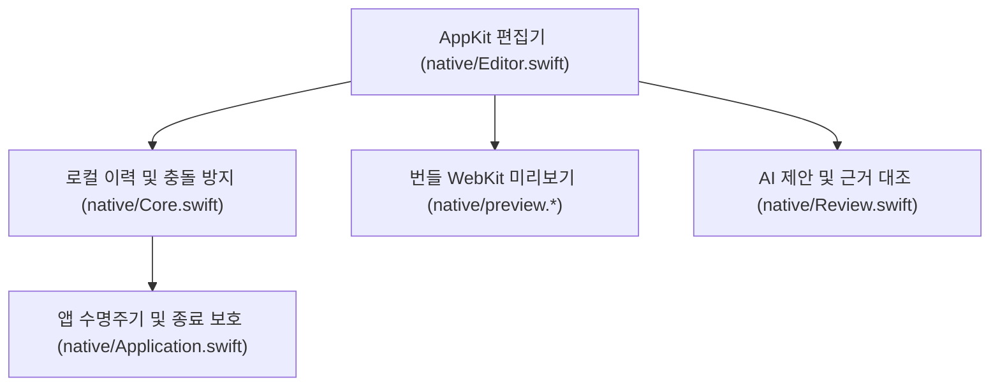

# 네이티브 macOS 앱 `Margin` 인수인계 (`handoff-incomplete-qualification`)

> **한 문단 요약**: 기본 제품인 네이티브 macOS 앱(`native-macOS-AppKit`)의 빌드와 자동 검증(`core` 66개, 헤드리스 `ui`와 `regressions` 38개, `quit`)은 통과했고, 재리뷰(`docs/.findings/native-final.md`) 판정은 `amend (경미)`이며 H1~H4는 해결되었습니다. 그러나 **앱 전체 최종 완료 상태가 아닙니다**. 실제 창에서의 포인터·키보드 편집 확인, 실 API 키 저장(`realKeychainWrite`), 라이브 AI 호출(`liveAI`), 재리뷰의 미조치 항목이 남아 있습니다. 다음 세션은 웹으로 되돌아가지 말고 아래 절차에 따라 남은 검증을 진행해 주십시오.

## 전체 그림: 아키텍처와 저장·검증 구조

네이티브 앱은 로컬 서버 없이 AppKit과 번들 WebKit만으로 동작하며, 입력 중단 1초 후 이름 없는 문서는 로컬 복구본에 저장되고 연결된 원본 파일이 있을 때는 원본도 함께 자동 저장됩니다.



- **사용자 확정 요구사항**: Markdown 소스/렌더링/분할 뷰(분할 시 각 패널 독립 선택), 작성 중 실시간 AI 사실확인·문장수정·문법교정 및 Cursor 방식 `Tab` 적용(Vercel AI Gateway 또는 Claude 연결), 자동 저장 및 버전 이력입니다. 사용자는 웹을 요청하지 않았으며 네이티브 macOS 앱으로 정정하셨으므로 다시 웹으로 진행하시면 안 됩니다.
- **저장 및 복구 계약**: 입력 중단 `1000`ms 후 로컬 `VersionStore`에 불변 스냅샷(`UUID.json`)과 포인터(`record.json`)를 기록하고, 연결된 파일 URL이 있으면 `NSDocument` 원본 자동 저장을 함께 수행합니다. 복원이나 원본 다시 열기 전에는 현재 소스를 먼저 스냅샷으로 보존하고 Undo 스택을 비웁니다. 종료 시에는 `applicationShouldTerminate`에서 로컬 플러시 후 미저장 원본 자동 저장이 끝날 때까지 `terminateLater`로 대기하며, `applicationWillTerminate`는 `--quit-check` 영수증 검사만 담당합니다.

## 소스 맵 및 구현 역할

모든 작업 소스는 `margin` 저장소 루트 아래에 있으며 아직 git untracked 상태입니다.

- `native/Application.swift`: CLI 진입점(`--check`, `--state-json`, `--ui-check`, `--quit-check`), `AppDelegate`, `NSDocument` 수명주기, 시작 시 최근 버전 복구, 종료 전 저장 대기(`applicationShouldTerminate`) 및 `--quit-check` 영수증 검사(`applicationWillTerminate`, `quitCheckDocument` 강한 참조 포함), 창 닫기 시 배열 해제를 담당합니다.
- `native/Core.swift`: `DocumentFormat`(UTF-8 BOM/CRLF 코덱), SHA256, `VersionStore` 원자적 불변 스냅샷과 `VersionSummary` 지연 로드, `FileGuard` 외부 수정 충돌 검사, UTF-16 문단 및 제안 적용 가드를 포함합니다.
- `native/Editor.swift`: 공유 `NSTextStorage` 기반 두 개의 `NSTextView` 패널, 소스/미리보기/분할 모드, 네이티브 `Tab`/Undo/고스트 텍스트, `150`ms 보이는 미리보기 디바운스, `1200`ms AI 리뷰 디바운스, IME/stale 가드를 구현합니다.
- `native/Sheets.swift`: Keychain 보안 키 설정 시트, 버전 시각·이유 목록 조회, 선택 버전 본문 단독 로드 및 복원 시트를 담당합니다.
- `native/Review.swift`: `URLSession` 기반 Claude/Gateway 직접 호출, `web_search_20250305`(`max_uses` 2) 사실확인, 실제 provider 검색/citation URL과의 교집합 검증, 근거 없는 사실/숫자 변경 차단, Keychain 읽기 오류와 키 없음 상태 구분을 수행합니다.
- `native/Checks.swift`: 임시 디렉터리를 사용하는 Core 66개 단언(assertion) 테스트입니다. 이 중 45개는 작업 공간 기능(`workspaceChecks`)입니다.
- `native/preview.html`, `native/preview.js`, `native/preview.css`: `marked`, `DOMPurify`, `Prism` 기반 번들 미리보기이며 렌더링 상태 그대로의 편집과 Markdown 역직렬화를 지원하고, 이미지 제거, 외부 네비게이션 차단, 사용자 클릭 링크만 `NSWorkspace`로 열기를 수행합니다.
- `native/icon.svg`, `native/make-icon.sh`, `native/Margin.icns`: 앱 아이콘 원본과 생성 스크립트, 생성물입니다. SVG를 고친 뒤 `bash native/make-icon.sh`로 `.icns`를 다시 만들며, `native/build.sh`는 생성물을 번들에 복사만 합니다.
- `native/build.sh`, `native/run.sh`, `package.json`: Swift 컴파일, `.app` 번들 생성, ad-hoc 서명 및 `source-sha256.txt` 생성을 수행합니다. Node는 빌드 시 기존 vendor 리소스 준비에만 쓰이며, `public/`, `server.mjs`, `ai.mjs`, `test/`는 대체된 구 웹 구현 참고용입니다.

## 현재 검증 완료 항목과 미완료 과제

최신 기준 영수증은 `docs/native-evidence.json`(`verifiedAt`: `2026-11-18T09:06:18Z`, 상태: `handoff-incomplete-qualification`)입니다. 이 절은 Codex 인수인계 이후 Claude 세션이 이어서 수행한 결과까지 반영합니다.

**검증 완료 항목 (`pass: true`)**
- **Core (`--check`)**: 66개 항목 통과(문서 21개 + 작업 공간 45개). 문서 쪽은 기존 18개에 손상 버전 3개(`corrupt latest version falls back to readable version`, `save continues after corrupt version`, `history lists corrupt version without loading it`)를 추가했습니다.
- **헤드리스 UI (`--ui-check`)**: 통과. `regressions` 38개 항목이 모두 `true`입니다. 작업 공간 8개(`workspace_tree_hides_ignored_and_secret`, `code_view_opens_and_saves`, `markdown_opens_in_rendered_pane`, `agent_steps_replayed_in_order`, `accept_advances_reject_restores`, `conflicting_reject_refuses`, `terminal_runs_command`, `agent_launch_is_explicit`)와 문서 18개입니다: `untitled_autosave_keeps_identity`, `untitled_system_autosave_keeps_identity`, `save_copy_keeps_identity`(H1), `restore_then_undo_safe`(H2), `close_then_reopen`(H3), `manual_save_conflict_preserves_current`(H4), `reopen_original_preserves_current`, `recovered_copy_blocks_duplicate_open`, `preview_edit_updates_source`, `preview_edit_rerenders`, `preview_serializer_roundtrip`, `rich_paste_converts_to_markdown`, `tags_render_as_chips`, `soft_line_break_in_preview`, `model_picker_offers_choices`, `auto_review_requires_connection`, `format_bar_only_on_editable_preview`, `checks_do_not_touch_keychain`.
- **종료 저장 (`--quit-check`)**: 통과. 실패 시 종료 코드가 1이 되도록 고쳤고 `npm run test:native`에 포함했습니다.
- **변형 검증**: Undo 초기화를 뺀 변형 빌드는 복원 후 실행 취소 단계에서 `NSRangeException`으로 종료되었습니다. H1, H3, H4를 각각 되돌린 변형 검증은 수행하지 않았습니다.
- **실제 실행**: `open build/Margin.app`으로 번들 실행 파일이 뜨고 1220x820 창에 소스와 미리보기가 렌더링되는 것을 화면 캡처로 확인했습니다. 재실행 시 "로컬 자동저장본을 복구했어요."가 표시되었습니다.
- **재리뷰**: `docs/.findings/native-final.md`, 판정 `amend (경미)`, H1~H4 해결됨.

**이 세션에서 추가·수정한 동작**
- **미리보기 편집(WYSIWYG)**: 미리보기는 렌더링된 상태 그대로 고칠 수 있고, 고친 내용이 Markdown 원문에 반영됩니다. `native/preview.js`가 사용자가 바꾼 블록만 렌더링 결과에서 Markdown으로 되돌려 쓰고, 손대지 않은 블록과 블록 사이 공백은 원문을 그대로 유지합니다. 되돌려 쓴 결과가 같은 렌더링을 만들지 못하는 블록(원시 HTML, 링크 정의 등)은 미리보기에서 잠기며 소스 패널에서 고칩니다. 체크박스 클릭, `⌘B`/`⌘I`, 일반 텍스트 붙여넣기를 지원하고 링크는 `⌘`-클릭으로 엽니다. 변경분은 `native/Editor.swift`의 `applyPreviewEdit`가 범위의 기존 내용을 확인한 뒤 공유 `NSTextStorage`에 적용합니다. 버전 이력의 미리보기는 읽기 전용입니다. 편집한 블록은 Markdown 표기가 정규화될 수 있습니다(예: `_기울임_`이 `*기울임*`으로, 참조 링크가 인라인 링크로).
- **서식 붙여넣기**: Google Docs 같은 곳에서 복사한 서식(`text/html`)을 Markdown으로 변환합니다. 미리보기에서는 렌더링된 내용으로 들어가고, 소스 패널에서는 Markdown 텍스트로 들어갑니다(`native/preview.js`의 `convertHTML`, `native/Editor.swift`의 `MarginTextView`). 전체가 코드 글꼴인 붙여넣기는 일반 텍스트로 유지합니다.
- **태그 칩**: 공백 뒤나 줄 처음의 `#이름`을 미리보기에서 칩으로 표시합니다. 숫자만 있는 `#123`은 제외하며 원문은 `#이름` 그대로입니다.
- **줄바꿈**: 원문의 줄바꿈 한 번을 미리보기의 줄바꿈으로 표시하고(`marked`의 `breaks:true`), 빈 줄이 문단을 나눕니다. 미리보기의 `Shift+Enter`는 문단을 나누지 않는 줄바꿈을 넣고 원문에는 줄바꿈 한 번으로 기록합니다. GitHub의 README 렌더링은 줄바꿈 한 번을 공백으로 처리하므로 그쪽과는 표시가 다릅니다.
- **서식 도구 막대**: 미리보기 패널 상단에서 문단 형식(본문·제목 1~3), 굵게, 기울임꼴, 취소선, 문장 내 코드, 목록 3종, 인용문, 코드 블록, 링크, 태그, 구분선을 적용합니다(`native/preview.js`의 `marginFormat`, `native/Editor.swift`의 `MarginPane.formatBar`). Markdown에 표기가 없는 글자 색상과 임의 글자 크기는 넣지 않았습니다.
- **링크**: 링크에 커서를 두면 주소와 열기·편집·링크 제거 버튼이 뜹니다. `⌘K`로 링크를 걸고, 글자를 선택한 채 URL을 붙여넣으면 링크가 되며, URL 뒤에 공백을 입력하면 자동으로 링크가 됩니다.
- **태그 입력**: `#이름` 뒤에 공백을 입력하면 바로 칩이 되고, 도구 막대의 태그 버튼은 선택한 글자를 칩으로 만들거나 해제합니다.
- **AI 설정**: 모델은 목록에서 고릅니다. Gateway는 공개 목록(`https://ai-gateway.vercel.sh/v1/models`)을 불러와 보여 주고 실패하면 내장 추천만 보입니다. API 키가 없으면 "AI 자동 교정" 체크박스는 꺼진 상태로 유지되고, 누르면 AI 설정 창이 열립니다.
- **화면 문구**: 119개 문구를 Gemini(`bin/gemini-write`)로 검토해 80개를 고쳤습니다. "AI 연결"은 "AI 설정", "버전 이력"은 "버전 기록", "실시간 AI"는 "AI 자동 교정", "문단 검토"는 "이 문단 AI 교정"이 되었습니다.
- **앱 아이콘**: `native/icon.svg`에서 만든 `native/Margin.icns`를 번들에 넣습니다.
- **분할 초기 위치**: 실제 실행에서 왼쪽으로 치우치던 분할을 `showWindow`에서 다시 잡도록 고쳤습니다.
- **복구본 중복 열기 차단**: 복구본이 열린 상태에서 같은 원본을 열면 새 문서를 만들지 않고 기존 창을 보여 줍니다.

**미완료 및 추가 검증 필요 항목**
- 실제 창에서 포인터와 키보드로 편집하는 동작(미리보기 블록 편집 포함)은 관찰하지 못했습니다. 합성 입력은 다른 창으로 들어갈 수 있으므로 사용하지 마십시오.
- 실제 Google Docs 클립보드로 붙여넣는 동작과 도구 막대 버튼의 실제 클릭, 링크 말풍선, 입력 중 자동 링크·자동 칩은 관찰하지 못했습니다. 헤드리스 검사는 Google Docs 형식을 본뜬 HTML과 합성 붙여넣기 이벤트를 사용합니다.
- 실제 Keychain 키 저장(`realKeychainWrite: "not-run"`)과 라이브 AI 호출(`liveAI: "not-run"`)은 API 키가 필요하며 검증하지 않았습니다.
- 미리보기에서 편집하는 중에는 AI 제안의 `Tab` 적용이 동작하지 않고 소스 패널에서만 동작합니다.
- 재리뷰의 미조치 항목은 `docs/.findings/native-final.md`의 표에 있습니다: 재실행 시 레코드 하나만 복구, `close()`의 `flush` 실패 경로, 손상 검사 범위, 시작 복구 경로의 헤드리스 검사 부재, M1·M6 부분 해결, L4.
- `docs/rtm.md`는 전 행이 `open`입니다. 작업이 커밋되지 않았고 위 항목이 남아 있기 때문입니다.
- **키체인 접근으로 인한 멈춤(해결)**: 창을 만들 때 API 키를 키체인에서 읽던 코드가 재빌드 직후 macOS의 접근 허용 창을 띄워 메인 스레드를 막았습니다. 그 결과 미리보기가 비어 보이고 `--ui-check`가 멈췄습니다. 지금은 `CredentialStore.exists`가 항목의 속성만 조회하고, 실제 키는 검토할 때 메인 스레드 밖에서 읽으며, 헤드리스 검사는 키체인을 건드리지 않습니다(`CredentialStore.keychainEnabled`). 검사가 다시 멈추면 40초 뒤 단계 이름을 stderr에 출력하고 종료 코드 1로 끝납니다.
- **남은 키체인 문제**: ad-hoc 서명은 빌드할 때마다 바뀌므로, 재빌드 뒤 첫 AI 교정에서 키체인 접근 허용 창이 다시 뜰 수 있습니다. 고정된 서명 인증서로 서명하면 사라지지만 적용하지 않았습니다.
- **진단 수단**: `build/Margin.app/Contents/MacOS/Margin --preview-json <파일>`은 Markdown 파일을 헤드리스로 렌더링해 블록 수, 잠긴 블록 수, 줄바꿈 수, 태그 수를 JSON으로 출력합니다. 미리보기 스크립트 오류는 stderr와 상태 표시줄에 표시됩니다.
- **알려진 제약(Known limits)**: 혼합 줄바꿈 첫 EOL 정규화, 이력 자동 정리(pruning) 없음, macOS 14 실기 미검증, ad-hoc 재빌드 간 Keychain 접근 호환 미검증, Mermaid/수식 미지원.

## 작업 공간(IDE) 기능: 에이전트 변경 따라가기

폴더를 작업 공간으로 열어 Claude에게 일을 시키면, 파일이 바뀔 때마다 "이유 + 변경 내용"이 한 단계로 기록되고, 그 단계를 순서대로 넘기며 수락하거나 거절할 수 있습니다. 상세 계약은 `docs/milestone-ide.md`와 `docs/srs.md`의 `FR-IDE-1`~`FR-IDE-6`, `NFR-IDE-1`입니다.

- **여는 방법**: 메뉴 `파일 > 폴더 열기…`(`⇧⌘O`), 기존 `열기`에서 폴더 선택, 또는 `Margin --workspace <폴더>`.
- **`native/Workspace.swift`**: 화면 없이 검사할 수 있는 핵심 로직입니다. `WorkspaceScanner`(파일 목록·스냅샷, 빌드 폴더·비밀 파일·1MiB 초과·비UTF-8 제외), `AgentStream`(스트림 한 줄 해석), `StepRecorder`(도구 결과가 돌아올 때마다 디스크를 다시 읽어 바뀐 파일을 한 단계로 기록), `LineDiff`, `StepReverter`(거절 시 되돌리기), `SessionStore`.
- **`native/Agent.swift`**: `LineProcess`(프로세스 출력을 줄 단위로 전달), `AgentLauncher`(`claude -p --output-format stream-json --verbose --permission-mode acceptEdits --allowedTools …`를 사용자의 로그인 셸로 실행), `ShellRunner`(줄 단위 셸, TTY 아님).
- **`native/Studio.swift`**: `StudioWindowController`. 왼쪽 파일 트리, 위쪽 `파일`/`변경 따라가기` 탭, 아래쪽 기록과 입력란입니다. Markdown은 기존 `MarginPane`을, 그 밖의 텍스트는 `CodePane`(줄 번호, 간단한 구문 색)을 씁니다.
- **단계를 디스크 기준으로 나누는 이유**: 에이전트는 `Edit` 도구뿐 아니라 `sed`나 스크립트로도 파일을 고칩니다. 도구 입력만 보면 그런 변경을 놓치므로, 도구 결과가 돌아온 시점마다 실제 파일 내용을 이전 스냅샷과 비교합니다.
- **"이유"의 출처**: 스트림의 thinking 블록은 비어 있는 경우가 많아서(실측), 에이전트가 화면에 말한 문장을 이유로 씁니다. 그래서 실행할 때 "변경 전에 이유를 한두 문장으로 말하라"는 시스템 프롬프트를 덧붙입니다.
- **거절 규칙**: 파일의 현재 내용이 그 단계의 결과와 같으면 이전 내용으로 되돌립니다. 뒤 단계가 같은 파일의 다른 곳을 고쳤다면, 그 단계가 바꾼 줄 묶음이 앞뒤 3줄과 함께 정확히 한 번 발견될 때만 그 부분만 되돌립니다. 그렇지 않으면 아무것도 쓰지 않고 거절을 거부합니다. `git checkout`·`stash`·`reset`은 쓰지 않습니다.
- **검증**: `native/fixtures/agent-stream.jsonl`(실제 실행 1회를 줄인 것)을 재생합니다. Core 66건 중 45건, UI `regressions` 38개 중 8개가 이 기능입니다. 실제 실행 진단은 `Margin --workspace-run <폴더> <지시> --snapshot <png>`이며 Claude를 실제로 호출합니다.
- **규모**: 파일 목록은 이름순 5000개까지만 다루고, 넘으면 기록 창에 경고를 한 번 표시합니다. 스캔은 메인 스레드에서 돌며, `Margin --scan-json <폴더>`로 잰 값은 파일 937개에서 첫 스냅샷 393ms, 도구 결과마다 반복되는 스냅샷 247ms입니다. 수천 개 규모에서는 화면이 잠깐씩 멈출 수 있습니다.
- **실행 환경**: Finder에서 띄운 앱은 터미널의 환경 변수를 물려받지 않습니다. 빈 환경의 로그인 셸에서는 `CLAUDE_CONFIG_DIR`이 비어 있었으므로, 그 경우 Claude는 기본 설정 폴더의 계정과 훅으로 실행됩니다.
- **미검증**: 실제 창에서의 포인터·키보드 조작(검토 화면의 `Tab` 키 포함), 파일 수천 개 규모의 작업 공간, Finder에서 띄운 앱에서의 Claude 실행.
- **알려진 한계**: 스냅샷에서 빠지는 파일(비밀 파일, 빌드 폴더, 1MiB 초과, 비UTF-8)의 변경은 단계로 나타나지 않습니다. 실행 중에 이 창 밖에서 사람이 고친 내용은 그때 진행 중인 단계에 섞입니다. 한 단계 안에서 일부 줄만 골라 수락하는 기능은 없습니다.

## 컨텍스트 0 재개 절차

작업 전 루트 및 작업 폴더 외 파일(`AGENTS.md`, `DOC_GUIDE.md`, `adapters`, `ai_system`, `tests`, 워크플로 상태 파일 등)은 절대 `reset`/`clean`/일괄 stage 하지 마십시오.

1. **문서 및 작업 트리 상태 확인**
   ```bash
   cd ~/ai-system
   cat AGENTS.md tools/markdown-studio/AGENTS.md tools/markdown-studio/HANDOFF.md
   cat tools/markdown-studio/docs/native-brief.json tools/markdown-studio/docs/.findings/native-final.md tools/markdown-studio/docs/native-evidence.json
   git status --short
   ```
2. **소스 해시 대조 및 네이티브 재검증**: 3종 검사의 JSON `"pass": true`를 확인합니다.
   ```bash
   cd margin
   shasum -a 256 -c build/Margin.app/Contents/Resources/source-sha256.txt
   bash native/build.sh --check
   build/Margin.app/Contents/MacOS/Margin --ui-check --state-json
   build/Margin.app/Contents/MacOS/Margin --quit-check
   ```
3. **실제 창 편집 확인**: `open build/Margin.app` 뒤 사용자가 직접 소스 패널과 미리보기 블록을 편집해 확인합니다.
4. **라이브 AI 검증**: API 키가 준비되면 "AI 연결"에서 Keychain에 저장하고 실제 문단으로 검토와 `Tab` 적용을 확인한 뒤 결과를 `docs/native-evidence.json`에 기록합니다.
5. **마감**: 남은 미조치 항목을 처리할지 결정하고, 커밋 뒤 `docs/rtm.md` 상태를 갱신합니다. 그때까지 워크플로 레지스트리는 `reflecting`으로 유지합니다.

## 부록: 환경, 경로 및 해시 참조

- **환경**: macOS `26.7.2` (`arm64`), Xcode `/Applications/Xcode.app/Contents/Developer`, Swift `6.4`, 빌드 타깃 macOS `14`. 소유했던 `markdown-studio-dev` tmux 웹 서버는 중지 완료했습니다.
- **런타임 경로**: 번들 `build/Margin.app`, 실행 파일 `build/Margin.app/Contents/MacOS/Margin`, 로컬 저장소 `~/Library/Application Support/com.peterlyoo.Margin/Documents` (`--state-json`으로 재확인). `.local/markdown-studio`는 임시 보관소이므로 재개 기준으로 쓰지 마십시오.
- **최신 바이너리 및 매니페스트 SHA256**: 값은 재빌드할 때마다 바뀌므로 `docs/native-evidence.json`의 `binarySHA256`, `bundleSourceManifestSHA256`, `sourceSHA256`과 번들 내 `source-sha256.txt`를 기준으로 삼으십시오.

## 2026-11-19 갱신

- **명령어 실행**: `bin/margin [폴더|파일 ...]`을 추가했고 `~/.local/bin/margin`에 심볼릭 링크를 두었습니다. 폴더는 `open -a build/Margin.app <경로>`로 전달되어 `MarginAppDelegate.open(_:)`이 작업 공간 창으로 엽니다. 폴더를 지정해 처음 실행하면 빈 문서 창을 추가로 만들지 않습니다(`native/Application.swift`의 `documents.isEmpty && studios.isEmpty`).
- **검토 탭**: 단계를 넘기면 파일 트리와 파일 보기가 따라가고(`파일 따라가기`), 파일 보기에서 입력 중이면 트리 선택만 이동합니다. 한 단계 안의 변경 부분 하나만 거절할 수 있습니다(`←/→`, `⇧⌫`). 이유는 `WHY:` 줄에서 읽습니다.
- **스캔**: 파일 한도는 20000개이고, 스캔은 백그라운드 직렬 큐에서 실행됩니다. 처음 스캔한 뒤에 새로 생긴 파일은 추적 대상이 한도의 2배가 될 때까지만 추가됩니다. 읽기 전용 도구만 실행한 뒤에는 스캔을 생략합니다.
- **종료**: 창을 닫으면 시작 대기 중이던 Claude 실행도 취소됩니다(`shutdown()`이 `stopRequested`를 설정).
- **검증**: `npm run test:native`(Core 66, `regressions` 38, `quit`)와 `build/Margin.app/Contents/MacOS/Margin --live-check`(실제 창에 이벤트를 넣는 검사)입니다. `--live-check`는 앱이 활성 상태가 아니면 행 클릭 항목이 실패할 수 있어 `npm run test:native`에는 포함하지 않았습니다.

## 2026-11-20 갱신

- **코드 정리 (FR-IDE-8)**: `native/Format.swift`. 확장자별 도구 목록에서 설치된 첫 도구를 절대 경로로 찾아(`~/.local/bin` 등 흔한 폴더, 없으면 로그인 셸의 PATH) 편집기 내용을 stdin으로 넘기고 stdout을 받습니다. 종료 코드 0이고 그동안 편집기 내용이 바뀌지 않았을 때만, 바뀐 가운데 부분만 한 번의 실행 취소 단위로 바꾸고 저장합니다. 이 Mac에는 `ruff 0.17.4`를 `uv tool install`로 설치했습니다(cooldown 점검 exit 0).
- **터미널 (FR-IDE-9)**: `native/Terminal.swift`. `TerminalScreen`(xterm-256color 화면 모델), `PTYSession`(`posix_openpt` + `posix_spawn`), `TerminalView`(그리기, 키, `NSTextInputClient`). macOS는 세션 리더가 터미널을 여는 것만으로 제어 터미널이 되지 않으므로, 자식은 Margin 실행 파일을 `--pty-exec`로 다시 실행해 `TIOCSCTTY`를 호출한 뒤 대상 프로그램으로 `execv`합니다. 창 크기는 슬레이브 쪽에 설정해야 반영됩니다.
- **진단 실행**: `Margin --format-run <폴더> <파일>`, `Margin --terminal-run <폴더> <입력> [--wait 초] [--snapshot png]`.
- **확인하지 못한 것**: 한글 입력기 조합(실제 키 입력 필요), 마우스로 끌어 선택하기, Nerd Font 아이콘 표시는 자동 검사와 캡처로 확인하지 못했습니다.
