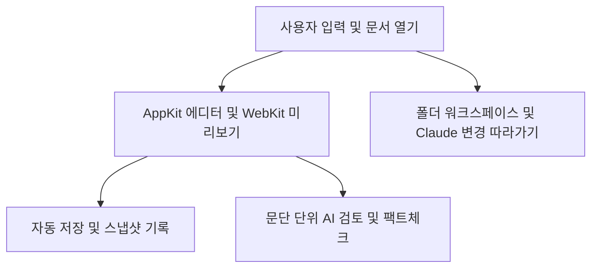

<p align="center"></p>

<h1 align="center">Margin</h1>

<p align="center">macOS 네이티브 Markdown 에디터이자 에이전트 워크스페이스입니다.</p>

<p align="center">
  
  
  
</p>

> Margin은 localhost 서버나 Node 프로세스 없이 실행되는 macOS 네이티브 Markdown 에디터이자 에이전트 워크스페이스입니다. AppKit의 `NSDocument`와 `NSTextView`를 기반으로 동작하며, WebKit은 Markdown 미리보기 렌더링에만 사용합니다. 이전 이름은 `markdown-studio`입니다.

---

## 전체 구조

Margin은 네이티브 문서 편집기, AI 문단 검토기, 그리고 폴더 단위의 에이전트 워크스페이스가 결합된 구조로 동작합니다.



- **AppKit 에디터 및 WebKit 미리보기**: 소스와 렌더링된 화면을 동시에 다루며, 미리보기에서 직접 편집한 내용도 Markdown 소스에 즉시 반영됩니다.
- **자동 저장 및 스냅샷 기록**: 입력이 멈추면 버전을 분리하여 저장하고 외부 변경 충돌을 막습니다.
- **문단 단위 AI 검토 및 팩트체크**: 작성이 멈춘 동안 현재 문단의 사실 관계와 문장을 점검합니다.
- **폴더 워크스페이스 및 Claude 변경 따라가기**: 프로젝트 폴더를 열고 Claude Code가 수행한 파일 변경을 단계별로 수락하거나 되돌립니다.

---

## 주요 기능

### 소스와 미리보기 양방향에서 편집하는 Markdown 에디터

모드를 자유롭게 전환하고 렌더링된 화면에서 직접 문서를 수정할 수 있습니다.

- 소스, 미리보기, 분할 모드를 지원하며 각 창을 독립적으로 선택할 수 있습니다.
- 렌더링된 미리보기 화면에서 직접 텍스트를 편집하면 Markdown 소스가 그에 맞춰 변경됩니다.
- 서식이 있는 텍스트를 붙여넣으면 Markdown으로 자동 변환합니다.
- `#tag`는 칩 형태로 렌더링되며, `Shift+Enter` 줄바꿈, 서식 도구 모음, 링크 버블, `⌘K` 링크 삽입, 자동 링크를 지원합니다.
- GitHub Flavored Markdown(GFM) 제목, 표, 작업 목록, 구문 강조가 적용된 코드 펜스를 렌더링합니다.
- 스크립트와 안전하지 않은 URL은 제거하며, 외부 이미지는 기본적으로 불러오지 않습니다.
- UTF-8 BOM과 CRLF 줄바꿈을 보존하며, 최대 2MB 크기의 `.md`, `.markdown`, `.txt` 파일을 지원합니다.

### 유실을 막는 자동 저장과 버전 기록

타이핑이 멈추면 변경 사항을 불변 버전으로 기록하고 충돌을 방지합니다.

- 입력이 멈춘 지 1초 후에 스냅샷을 자동으로 저장합니다.
- 타임스탬프가 찍힌 불변 버전으로 관리되며, 기록 패널에서 소스와 렌더링된 미리보기를 모두 확인할 수 있습니다.
- 이전 버전을 복원하면 기존 기록을 지우지 않고 새로운 버전으로 추가합니다.
- 외부 변경 충돌 감지 기능이 있어 외부에서 수정된 파일을 덮어쓰지 않고 멈춥니다.
- 앱 실행 시 비정상 종료 복구를 수행하며, 데이터는 Application Support 아래에 저장됩니다. 저장 경로는 `--state-json` 옵션으로 확인할 수 있습니다.

### 웹 검색 증거로 검증하는 AI 문단 검토

입력 후 잠시 멈추면 현재 문단의 사실 관계와 표현, 문법을 검토합니다.

- 한글 입력기 조합 중이 아닐 때 1200ms 동안 입력이 멈추면 현재 문단을 최대 6000 UTF-16자까지 검토합니다.
- `Tab` 키로 제안을 적용하고 `Esc` 키로 닫으며, 적용한 내용은 실행 취소가 가능합니다. 이미 지나간 오래된 제안은 적용되지 않습니다.
- 제공자로 Vercel AI Gateway(기본 모델 `anthropic/claude-sonnet-5.5`) 또는 Claude 직접 연결(기본 모델 `claude-sonnet-5-5`)을 사용할 수 있습니다.
- API 키는 macOS 키체인에 저장하거나 `AI_GATEWAY_API_KEY`, `ANTHROPIC_API_KEY` 환경 변수로 전달합니다.
- 팩트체크는 제공자 서버의 웹 검색을 사용하며, 실제 검색 결과의 인용 URL만 증거로 인정합니다. 근거가 뒷받침되지 않는 사실이나 수치 변경은 차단하고 미검증으로 표시합니다.

### 코드 편집과 파일 관리를 통합한 폴더 워크스페이스

폴더 단위로 프로젝트를 열어 Markdown과 일반 코드 파일을 함께 다룹니다.

- 메뉴의 `파일 > 폴더 열기…` 또는 `⇧⌘O` 단축키로 폴더 워크스페이스를 엽니다.
- 파일 트리는 빌드 폴더, `.env`나 키 같은 비밀 유사 파일, 1 MiB를 초과하는 파일을 자동으로 숨깁니다.
- Markdown 파일은 렌더링 창에서 열리고, 그 외의 텍스트 파일은 줄 번호와 구문 색상이 적용된 코드 뷰에서 열립니다.
- 외부 변경 보호가 적용된 자동 저장이 동작하며, `⌘K ⌘B`로 파일 트리 사이드바를 여닫을 수 있습니다. 사이드바 상태는 유지됩니다.

### Claude의 파일 변경을 단계별로 검토하고 반영

지시사항을 입력하면 Claude Code가 백그라운드에서 작업하고, 사용자는 변경 내역을 한 단계씩 수락하거나 거절할 수 있습니다.

- 지시사항을 입력하면 폴더 안에서 Claude Code가 `--permission-mode acceptEdits` 옵션으로 헤드리스 실행됩니다.
- 각 파일 변경 사항은 Claude의 변경 이유와 줄 단위 diff가 포함된 하나의 단계가 됩니다.
- `변경 따라가기` 탭에서 `↑`/`↓`로 이동하고, `Tab`으로 수락하며, `Delete`로 거절할 수 있습니다. 거절 시 해당 단계의 변경만 복원하며 이후에 다시 변경된 파일은 복원을 거부합니다. `⇧⌫`를 누르면 한 부분만 거절합니다.
- 세션은 워크스페이스별로 유지됩니다.
- `Claude의 셸 명령 허용` 토글을 끄면 파일 읽기와 편집만 허용합니다.

### 설치된 도구를 활용하는 코드 포맷팅과 들여쓰기

언어별 표준 포맷터를 호출해 한 번의 실행 취소 가능한 편집으로 코드를 정리합니다.

- `⌥⌘L`을 누르면 시스템에 설치된 도구를 사용해 포맷팅합니다.
- Python은 `ruff`(없으면 `black`), Go는 `gofmt`, Rust는 `rustfmt`, Swift는 `swift-format`, JS/TS/CSS/HTML/YAML/Markdown은 `prettier`, JSON은 `prettier`(없으면 `jq`)를 사용하며, 기타 언어 규칙은 `native/Format.swift`에 정의되어 있습니다.
- 포맷팅이 실패하거나 20s 시간 초과가 발생하면 아무것도 변경하지 않습니다.
- `Enter` 키는 들여쓰기를 유지하며 `:`, `{`, `(`, `[` 뒤에서는 한 단계 더 들여씁니다. `Tab`과 `Shift-Tab`으로 들여쓰기와 내어쓰기를 조절합니다.

### 디스크에 남지 않는 내장 터미널

워크스페이스 안에서 실제 가상 터미널(PTY) 기반의 로그인 셸을 바로 실행합니다.

- ``Control+` `` 단축키 또는 `터미널` 탭으로 열 수 있습니다.
- `vim`, `less`, `top`, `Ctrl-C`, 한글 입력, 복사 및 붙여넣기, 스크롤백을 지원합니다.
- 터미널 내용은 디스크에 절대 기록되지 않습니다.

### 파일 내부와 워크스페이스 전체를 아우르는 검색

현재 문서 안에서의 빠른 탐색과 폴더 전체 정규식 검색을 모두 제공합니다.

- Sublime 스타일의 파일 내 찾기(`⌘F`)와 찾기 및 바꾸기(`⌥⌘F`)를 지원합니다. 한 줄을 선택한 상태에서 `⌘F`를 누르면 검색어가 되며, 미리보기 화면에서는 소스 화면으로 전환됩니다.
- PyCharm 스타일의 파일에서 찾기(`⇧⌘F`)는 워크스페이스 폴더 아래의 추적 중인 모든 파일을 검색합니다.
- 전체 검색은 대소문자 구분 여부, 단어 단위, 정규식을 지원합니다. 파일 마스크는 상대 경로에 대한 대소문자 무시 정규식(예: `\.(py|md)$`, `^src/`, 비워두면 전체)으로 동작하며, 잘못된 정규식은 오류를 표시합니다.
- 검색 결과에서 `Enter`를 누르거나 더블 클릭하면 해당 일치 항목이 선택된 상태로 파일이 열립니다. 비밀 파일은 검색하지 않으며 최대 5000개의 결과를 표시합니다.

---

## 단축키 모음

자주 사용하는 편집, 탐색, 워크스페이스 제어 단축키입니다.

| 단축키 | 동작 |
| :--- | :--- |
| `⇧⌘O` | 폴더 워크스페이스 열기 |
| `⌘K ⌘B` | 파일 트리 사이드바 토글 |
| `⌘K` | 링크 삽입 |
| `Shift+Enter` | 줄바꿈 |
| `Tab` / `Esc` | AI 검토 제안 적용 / 닫기 |
| `Tab` / `Shift-Tab` | 들여쓰기 / 내어쓰기 |
| `⌥⌘L` | 코드 포맷팅 실행 |
| ``Control+` `` | 내장 터미널 열기 |
| `⌘F` | 파일 내 찾기 바 열기 |
| `⌥⌘F` | 파일 내 찾기 및 바꾸기 |
| `⌘G` / `⇧⌘G` | 다음 / 이전 일치 항목 찾기 |
| `⌃⌘G` | 일치하는 항목 모두 선택 |
| `⌘E` | 선택 영역을 검색어로 사용 |
| `⌘J` | 선택 영역으로 스크롤 |
| `⇧⌘F` | 워크스페이스 파일 전체에서 찾기 |
| `↑` / `↓` | 변경 따라가기 탭에서 단계 이동 |
| `Tab` / `Delete` / `⇧⌫` | 변경 따라가기에서 수락 / 단계 거절 / 부분 거절 |

---

## 빠른 시작

macOS 14 이상과 Xcode 툴체인의 `swiftc`, 그리고 빌드 시점에 번들 리소스를 복사하기 위한 Node 22.9 이상이 필요합니다.

1. **요구 사항 확인**: Swift 패키지는 사용하지 않으며, Node(`>=22.9`)는 빌드 시점에 `marked` 18.1.3, `DOMPurify` 3.4.17, `Prism` 1.30.0 리소스를 앱 내부로 복사하는 용도로만 쓰입니다. 앱은 로컬 애드혹 코드 서명을 사용합니다.
2. **저장소 복제 및 의존성 설치**: 아래 명령을 실행하면 리소스 복사에 필요한 패키지가 준비됩니다.
   ```bash
   git clone https://github.com/chlyoo/margin.git && cd margin
   npm ci
   ```
3. **네이티브 앱 빌드**: 빌드 스크립트를 실행하면 `build/Margin.app` 번들이 생성됩니다.
   ```bash
   bash native/build.sh
   ```
4. **앱 실행**: 생성된 앱을 직접 열거나 npm 스크립트로 실행합니다.
   ```bash
   open build/Margin.app
   # 또는
   npm start
   ```

---

## 명령줄에서 열기

`bin/margin` 스크립트를 `PATH`에 심볼릭 링크로 등록하면 터미널에서 파일과 폴더를 바로 열 수 있습니다.

```bash
ln -s "$PWD/bin/margin" ~/.local/bin/margin
```

- `margin .`: 현재 폴더를 워크스페이스로 엽니다.
- `margin ~/repo/app`: 지정한 폴더를 워크스페이스로 엽니다. 이미 열려 있는 폴더는 기존 창을 재사용합니다.
- `margin notes.md`: 지정한 파일을 문서 창으로 엽니다.
- `margin`: 실행 중인 앱을 화면 앞으로 가져옵니다.
- 존재하지 않는 경로를 입력하면 `margin: <path>: no such file or folder`를 출력하고 종료 코드 `1`로 종료합니다.

---

## 개발·검증

Node 테스트와 네이티브 바이너리 자체 점검 옵션을 통해 코어 로직과 UI 회귀 항목을 검증합니다. 최근 실행 기준으로 코어 점검 66개 통과, UI 회귀 점검 41개 항목 통과, 종료 점검 통과를 확인했습니다.

- **전체 테스트 실행**: Node 테스트와 네이티브 코어 점검을 함께 실행합니다.
  ```bash
  npm test
  ```
- **네이티브 검증 실행**: 네이티브 코어 점검, `--ui-check --state-json`, `--quit-check`를 차례로 검증합니다.
  ```bash
  npm run test:native
  ```
- **바이너리 직접 점검**: 빌드된 실행 파일에 플래그를 전달해 상태를 직접 확인할 수 있습니다.
  ```bash
  build/Margin.app/Contents/MacOS/Margin --check
  build/Margin.app/Contents/MacOS/Margin --state-json
  ```

---

## 알려진 한계

현재 버전에서 지원하지 않거나 사용 시 유의해야 할 제약 사항입니다.

- 한 파일 안에 줄바꿈 방식이 섞여 있으면 첫 번째 줄바꿈(EOL) 문자로 통일됩니다.
- 버전 기록 자동 정리(pruning)나 클라우드 동기화 기능은 없습니다.
- Mermaid 다이어그램이나 수식 렌더링 엔진을 포함하지 않습니다.
- 자동화된 검증 명령은 실제 유료 API 호출이나 실제 키체인 키 저장을 테스트하지 않습니다.
- AI의 사실 여부 및 의미 판단은 완벽하지 않으므로 사람의 검토가 필요합니다.
- 파일 내 찾기 바(`NSTextFinder`)는 정규식을 지원하지 않습니다. 정규식 검색은 `⇧⌘F` 전체 파일 찾기에서만 가능합니다.
- 멀티 커서를 지원하지 않습니다.
- 폴더 워크스페이스는 첫 스캔 시 최대 20000개의 파일까지만 추적합니다.
- 구버전 웹 UI(`npm run debug:web`)는 개발 참고용으로만 남아 있습니다.

---

## 프로젝트 구조

네이티브 Swift 소스와 빌드 스크립트, 문서, 레거시 참고 파일로 구성되어 있습니다.

- `native/`: Swift 소스 파일(`Application`, `Studio`, `Editor`, `Search`, `Terminal`, `Workspace`, `Format`, `Review`, `Agent`, `Checks`, `Core`, `Sheets`)과 미리보기 리소스(`preview.html`, `preview.js`, `preview.css`), 빌드 및 실행 스크립트(`build.sh`, `run.sh`)가 위치합니다.
- `bin/margin`: 명령줄 실행 스크립트입니다.
- `docs/`: 요구사항 및 검증 문서(PRD, SRS, RTM, evidence)가 들어 있습니다.
- `public/`, `server.mjs`, `ai.mjs`: 개발 참고용으로 보존된 레거시 웹 UI 파일입니다.
- `test/`: 테스트 코드가 위치합니다.
