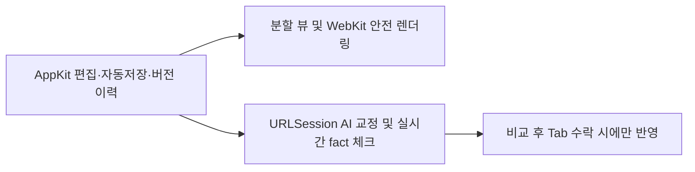

# PRD: Markdown Studio

> **요약**: Markdown 렌더링에 최적화된 편집 시스템, AI 자동 교정 및 실시간 fact 체크, 자동저장과 버전 이력 기능을 갖춘 macOS 네이티브 앱(`Margin.app`)을 `tools/markdown-studio` 경로에 구축하는 것을 목표로 합니다. AppKit(`NSDocument`/`NSTextView`)으로 편집·메뉴·설정·버전 이력을 제공하고 WebKit은 번들 Markdown 미리보기만 담당하며, localhost 서버 없이 동작합니다.

## Purpose
사용자가 단일 문서 소스를 바탕으로 소스/렌더링 선택 및 분할 화면에서 편집하고, 문구 편집 시 자동 교정 제안이나 실시간 fact 체크, 문장 수정, 문법 교정 제안을 받아 Tab으로 안전하게 반영하며, 자동저장과 버전 이력으로 작업 유실을 방지하도록 돕는 것을 목표로 합니다.

## Problem statement
Markdown 문서를 작성할 때 안전한 실시간 렌더링 확인과 문맥을 유지하는 문구 교정, 실시간 fact 체크를 한 화면에서 처리하기 어렵습니다. 또한 외부 AI 연결 시 파일이나 브라우저에 API 키가 노출되거나, 제안이나 근거 없는 사실 수정 및 외부 파일 변경이 원문을 자동으로 덮어써 작업 내용을 잃을 위험을 방지해야 합니다.

## Goals
- **FR-MD-1 (뷰 전환 및 분할)**: 하나의 문서 소스를 기준으로 소스/미리보기/분할 3가지 모드 전환과 양쪽 독립 뷰 선택을 지원하는 것을 목표로 합니다.
- **FR-MD-2 (안전한 Markdown 렌더링)**: WebKit과 번들된 marked + DOMPurify + Prism을 사용해 제목, 표, 체크리스트, 인용, 코드 블록 및 코드 강조를 렌더링하고 원시 HTML을 sanitization 처리하며 외부 이미지는 기본 제거합니다.
- **FR-MD-3 (파일 편집/저장/복구)**: `NSDocument` 표준 열기/저장/다른 이름 저장, UTF-8 BOM/CRLF 보존, 최대 2MB Markdown/txt 편집 및 시작 시 최근 자동저장본 복구를 제공합니다.
- **FR-MD-4 (AI 교정 제안과 적용)**: 입력 중지 1200ms 후 현재 문단(최대 6000 UTF-16 chars)만 검토하며 한글 조합(marked text) 중 호출을 차단합니다. 원문/수정문 비교 후 현재 커서 문단 제안만 Tab 수락, Esc 취소, Undo를 지원합니다.
- **FR-MD-5 (실시간 fact 체크 및 근거 검증)**: 실시간 fact 체크(기본 켜짐), 문장·문법 교정을 위해 Claude 서버 웹 검색 도구(`web_search_20250305`, `max_uses` 2)를 사용하고 실제 서버 검색 결과와 citation URL만 근거로 인정하며, 미확인 사실이나 근거 없는 숫자 변경은 차단합니다.
- **FR-MD-6 (macOS 네이티브 앱)**: localhost 서버나 Node 프로세스 없이 실행되는 `Margin.app`(`Contents/MacOS/Margin`)을 제공하며, AppKit `NSDocument`/`NSTextView` 기반 네이티브 에디터와 메뉴, AI 연결 설정, 버전 이력 UI를 제공합니다.
- **FR-MD-7 (자동저장과 충돌 차단)**: 입력 중단 1초 뒤 로컬 복구본과 지정된 원본 파일 자동저장을 수행하고 종료 시 대기 중인 복구 저장을 flush합니다. 저장 실패나 외부 원본 수정 감지 시 오류를 표시하고 덮어쓰기를 중지하며, 시작 시 원본과 다른 복구본은 untitled로 열어 자동 덮어쓰기를 방지합니다.
- **FR-MD-8 (불변 버전 이력과 복원)**: 시각·이유별 immutable 버전 스냅샷 목록과 소스/렌더링 미리보기를 제공하고 동일 내용 중복 버전은 생성하지 않습니다. 이전 버전 복원 전 현재 내용을 보관하고 복원 결과를 새 버전으로 추가하며 기존 버전은 삭제하지 않습니다.

## Non-goals
웹 앱 기본 제공(`debug:web`은 개발용 참고자료), 공유 서비스, 클라우드 동기화, 버전 자동 정리, 사용자 확인 없는 원문 덮어쓰기, 공개 배포는 범위 밖으로 규정합니다.

## Success metrics
- 검증은 `build/Margin.app/Contents/MacOS/Margin --check`, `--state-json`, `--ui-check --state-json` 및 `npm run test:native` 통과를 기준으로 삼습니다.
- 실제 유료 API 호출과 실 API 키 보관은 검증하지 않았으므로 연결 구현만 확인하고 라이브 성공으로 표기하지 않습니다.

## Constraints
- macOS 14+ 대상 Swift 6.4/Xcode 빌드(`npm ci` 후 `bash native/build.sh`)와 로컬 ad-hoc 서명을 사용하며, Node 의존성은 빌드 시 marked/DOMPurify/Prism 리소스 복사 용도로만 사용합니다.
- **NFR-SEC-1**: API 키는 네이티브 설정을 통해 macOS Keychain에 보관(`.env`나 브라우저 불필요)하고 환경변수(`AI_GATEWAY_API_KEY`, `ANTHROPIC_API_KEY`) fallback만 허용하며, 저장 경로는 `FileManager` ApplicationSupport URL에서 런타임 해석합니다.

## Risks
- AI 응답 대기 중 source revision, 대상 텍스트, 커서 위치가 변경되면 어긋남이 발생할 수 있으므로 변경 감지 시 제안을 폐기합니다.
- 사실 근거의 의미와 이름/의미 분류는 AI 판단이므로 사용자가 근거를 직접 검토해야 합니다.

## Decisions
- 네이티브 `URLSession`으로 Vercel AI Gateway(기본 모델 `anthropic/claude-sonnet-5.5`, https://ai-gateway.vercel.sh/v1/chat/completions 및 fact-check용 https://ai-gateway.vercel.sh/v1/messages )와 직접 Claude(기본 모델 `claude-sonnet-5-5`, https://api.anthropic.com/v1/messages )를 연결하고 UI에서 모델을 편집 가능하도록 결정합니다.

## Children
하위 실행 계획 문서인 `milestone.md` 를 포함하며, 상세 요구사항 `srs.md` 및 검증 추적 `rtm.md` 를 함께 관리하는 것을 목표로 합니다.
